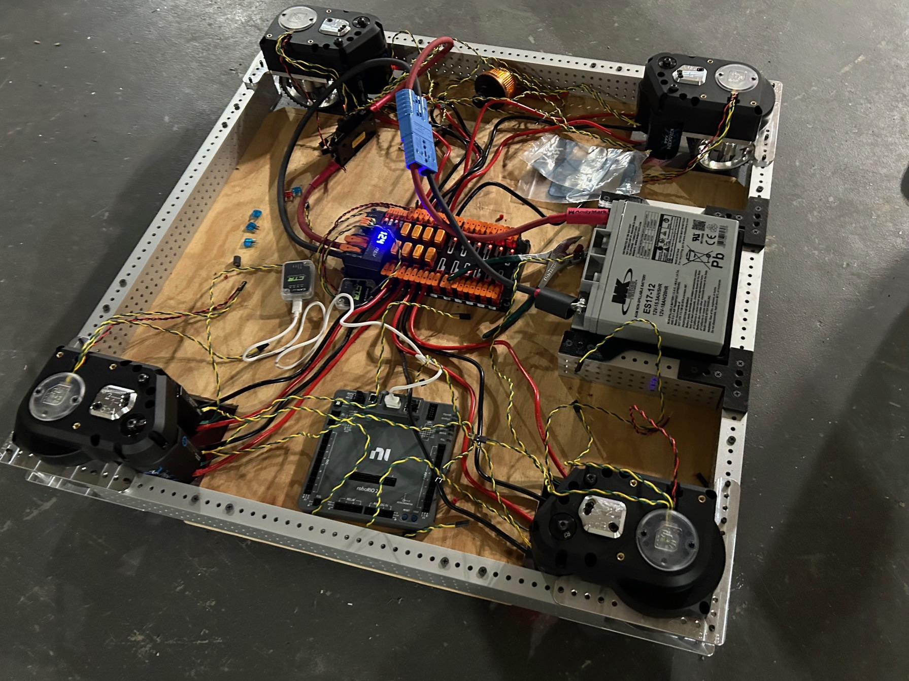
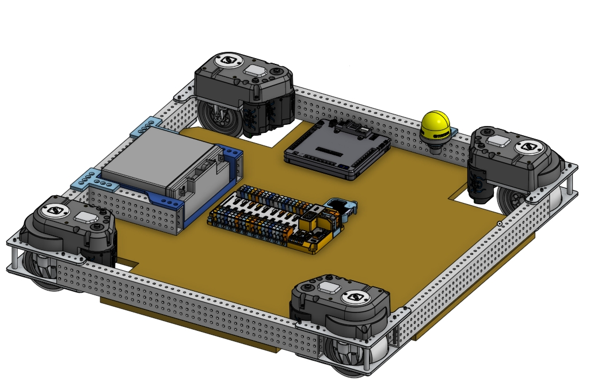

# Team 10978 Robot Code — 2027 (Systemcore)

Robot code for the 2027 season (**BIOCORE**, kickoff January 9, 2027), built for the new
**Systemcore** controller. The focus is the best possible field tracking: a **Meta Quest 3S running
QuestNav**, fused with **PhotonVision AprilTags** and 250 Hz swerve odometry, with **AdvantageKit**
logging so every match can be replayed and debugged.

 

[Open CAD in Onshape](https://cad.onshape.com/documents/db62f2b6add2ee74bb2e245e/w/398e5813f78ea908a32de61f/e/f1b21e5a7c2413f70d70355e?renderMode=0&uiState=692678b20accc2e6f3a5d113)

> [!WARNING]
> **Everything 2027 is still alpha software.** WPILib 2027, Systemcore, AdvantageKit 27, Phoenix 6
> 26.70, ChoreoLib 2027 and PhotonLib 2027 all change between releases. Expect to update versions
> (and fix small API changes) before and after kickoff. See [Versions](#versions).

---

## What this code does

| Feature | How |
|---|---|
| Swerve drive | Kraken X60 drive, Kraken X44 steer, CANcoders, Pigeon 2, all on the CANivore. AdvantageKit swerve with a 250 Hz synchronized odometry thread. |
| Tracking | **Quest 3S (QuestNav)** + **PhotonVision multi-tag AprilTags** + wheel odometry, fused in one pose estimator. Auto-seeding, drift detection and re-seeding from AprilTags. |
| Game pieces | PhotonVision **object detection** (Orange Pi 5 NPU) → field positions using the fused pose (latency compensated) → tracked and smoothed. |
| Auto-align | `DriveToPose`: motion-profiled drive straight to any field pose. Used for "drive to game piece" and the end of every auto path. |
| Autos | **Choreo** paths with module-force feedforward, plus PID on the fused pose. |
| Driver practice | Full simulation: simulated Quest, simulated AprilTag cameras and simulated game pieces. Drive it with an Xbox controller and watch it in AdvantageScope. |
| Debugging | **AdvantageKit**: every sensor, camera frame, Quest frame and controller input is logged. Replay any match and change the code to see what would have happened. |
| Tuning | Live tunable gains (`/Tuning/...` in NetworkTables) when `Constants.tuningMode = true`. |

## How tracking works

```
 Swerve modules + Pigeon 2 ──250 Hz──►┐
                                      │
 Quest 3S (QuestNav VIO) ──120 Hz────►├──► SwerveDrivePoseEstimator ──► drive.getPose()
   (std dev ~2 cm)                    │       (one fused field pose)       │
                                      │                                    ├─► Choreo autos
 PhotonVision AprilTags ──~40 Hz/cam─►┘                                    ├─► DriveToPose / auto-align
   (std dev grows with distance²,                                          └─► game piece positions
    shrinks with # of tags)
          │
          └──► QuestNavSubsystem: seeds the Quest the first time it sees good tags,
               and re-seeds it if the Quest drifts more than 12 cm from good AprilTag fixes.
```

- **QuestNav** is the backbone: it's smooth, high-rate, and doesn't care about wheel slip or being
  pushed. But it only knows where it is relative to where it started, so it must be **seeded**.
- **Seeding** happens automatically: (1) whenever the pose is hard-reset (auto start, driver reset),
  or (2) from the first good PhotonVision multi-tag fix when the robot is slow.
- **Drift protection**: every accepted AprilTag fix is compared with where the Quest said the robot
  was at that same moment. If the average error grows past 12 cm, the pose is re-seeded from tags.
- **Safety checks** on every Quest frame: tracking flag, timestamp sanity, robot height, field
  bounds, and disagreement with the estimator. If the Quest is unplugged or loses tracking, the
  robot keeps driving on odometry + AprilTags automatically.
- **Wheel-only odometry** is also logged (`Odometry/WheelOnly`), so you can compare it with the
  fused pose in AdvantageScope.

## Controls

**Driver (Xbox, port 0)**

| Input | Action |
|---|---|
| Left stick | Drive (field relative, from the driver's point of view) |
| Right stick X | Rotate |
| Right trigger (hold) | Slow / precision mode |
| Left trigger (hold) | Drive onto the closest tracked game piece |
| Left bumper (hold) | Keep driving, but always face the closest game piece |
| Right bumper (hold) | X-lock wheels (defense) |
| D-pad | Snap to a heading (up = away from you, left/right/down) while driving |
| Menu (start) | Reset heading (emergency only; QuestNav and tags normally handle it) |

**Operator (Xbox, port 1)**

| Input | Action |
|---|---|
| View (back) | Re-seed QuestNav from the current pose (after a Quest restart) |
| _Everything else_ | Reserved for BIOCORE mechanisms after kickoff |

The driver controller rumbles when QuestNav stops being healthy during teleop.

## Getting started

1. Install the **WPILib 2027 Alpha 7** installer:
   https://github.com/wpilibsuite/allwpilib/releases/tag/v2027.0.0-alpha-7
   (Java 25 and the 2027 VS Code come with it.)
2. Open this folder in the 2027 WPILib VS Code.
3. Build: `./gradlew build` (Windows: `gradlew build`). The first build downloads the vendor libraries.
4. Simulate: `./gradlew simulateJava`, then open **AdvantageScope 2027 alpha** and connect to
   `localhost`. Drag `Odometry/Robot`, `QuestNav/RobotPose` and `ObjectDetection/TrackedPieces`
   onto a 3D field.
5. Deploy (once you have a Systemcore): `./gradlew deploy`.

GitHub Actions builds the code and runs the unit tests on every push (`.github/workflows/build.yml`).

### Driver practice in simulation

Simulation is set up for driving practice: plug an Xbox controller into the computer, run
`./gradlew simulateJava`, enable Teleop in the 2027 Driver Station (or the sim GUI), and drive. The
simulated robot has a simulated Quest (with a little drift, so drift correction runs), two simulated
AprilTag cameras, and six simulated game pieces to practice "drive to game piece" with.

## Hardware setup

### Systemcore and CAN

- Systemcore replaces the roboRIO. Flash the latest image from
  https://github.com/LimelightVision/systemcore-os-public (image 14+ for WPILib alpha 7).
- **CANivore:** install CTRE's `canivore-usb` package for your Systemcore image (links in
  https://github.com/wpilibsuite/SystemcoreTesting/blob/main/CTR-Phoenix.md).
- **Phoenix firmware:** Phoenix 6 `26.70.0-alpha-2` needs **device firmware 26.70.x**. Update every
  Kraken, CANcoder and the Pigeon with **Phoenix Tuner X Preview**.
- The CANivore name in `TunerConstants.kCANBus` must match Tuner X (currently `"Default Name"`).
  Renaming it to `canivore` in Tuner X is recommended.
- No Phoenix Pro, so the code uses `RemoteCANcoder` and voltage control (both work without Pro).

### Meta Quest 3S (QuestNav)

1. **Headset setup:** follow https://questnav.gg (Quick Start), or use https://setup.questnav.gg.
   Install the latest QuestNav app. The 2026-3.0.0 beta adds on-headset AprilTag correction, which
   works together with this code.
2. **Ethernet adapter:** must be on QuestNav's tested list. Recommended: **Cable Matters 5-Port USB-C
   Hub** (Ethernet + power passthrough). Many adapters (Anker, UGREEN...) do not work.
3. **Power:** a USB battery bank through a **USB-A to USB-C** cable into the adapter's power port
   (prevents USB-PD boot loops). Alternative: a regulated 5 V converter like the Redux Zinc-V.
4. **Mount:** rigid, with a clear view of the field. The Quest 3S has no lens tilt (unlike the Quest
   3). A 3D-printed mount is linked in the QuestNav docs (PETG or CF-Nylon, 25-30% infill).
5. **Measure the mount!** Set `QuestNavConstants.ROBOT_TO_QUEST` from robot center (on the floor) to
   the point between the two lenses. This is the most important number in the whole tracking system.
6. Robot code: nothing to install. The QuestNav 2027 robot library is included in
   `src/main/java/gg/questnav` until QuestNav publishes a 2027 vendordep (see the README there).

### PhotonVision (Orange Pi 5, 2-4 cameras)

1. Flash PhotonVision for Orange Pi 5. Use a 2027-compatible PhotonVision build (Systemcore changed
   some NetworkTables topics; old builds can't see that the robot is enabled).
2. Use global-shutter cameras for AprilTags (for example Arducam OV9281) and calibrate every camera
   at the resolution you'll use.
3. AprilTag cameras: enable **3D mode** and **MultiTag** on the coprocessor. Camera names must match
   `VisionConstants.CAMERAS`; set each camera's `robotToCamera` from CAD.
4. Object detection camera: color camera, **Object Detection** pipeline with an RKNN model for the
   game piece (train after kickoff, or use a community model). Set `ObjectDetectionConstants`.
5. Give the Orange Pi a static IP on the robot network.

### LiDAR — recommendation

**Skip spinning LiDAR.** QuestNav + AprilTags + odometry already give centimeter-level tracking, and
a 2D LiDAR (RPLidar etc.) needs its own coprocessor driver, filtering and fusion code for little
gain, and is easily confused by bumpers and the field's polycarbonate. If a game task needs a
distance (wall, game piece in the intake, scoring height), use a **CTRE CANrange** time-of-flight
sensor on the CANivore — it's cheap, logs through Phoenix, and fits the IO pattern used here.

## Tuning checklist (in order)

1. **Module offsets** (Tuner X) and **CAN IDs** in `TunerConstants`.
2. **Drive kS/kV:** run auto "Drive Simple FF Characterization" on the floor; copy into `driveGains`.
3. **Wheel radius:** run "Drive Wheel Radius Characterization"; copy into `kWheelRadius`.
4. **Steer gains** if modules oscillate (start from `kP = 100`, raise `kD` slightly).
5. **Measure `ROBOT_TO_QUEST`** and every `robotToCamera`.
6. Drive in a square and come back to the start: `Odometry/Robot` and `QuestNav/RobotPose` should
   return to within ~2 cm. Then run the **"Localization Test"** auto.
7. Tune QuestNav and vision trust (`/Tuning/QuestNav/...`) with log replay.
8. Tune Choreo following (`/Tuning/Drive/PathFollowing/...`) and `DriveToPose` gains.
9. Set `Constants.tuningMode = false` for competition.

## After kickoff (BIOCORE) to-do

- [ ] Update `FieldConstants.FIELD_TYPE` to the 2027 field (when WPILib adds it).
- [ ] Check `FieldConstants.SYMMETRY` (rotated vs mirrored field).
- [ ] Train/choose the game piece model; set `GAME_PIECE_CLASS_IDS` and `GAME_PIECE_CENTER_HEIGHT`.
- [ ] Add mechanism subsystems using the IO pattern (`XxxIO`, `XxxIOTalonFX`, `XxxIOSim`).
- [ ] Operator controls, scoring poses for auto-align, Choreo paths and autos.
- [ ] Weigh the robot: `DriveConstants.ROBOT_MASS_KG` and the Choreo robot config.

## Project layout

```
src/main/java/first/robot/
  Robot.java               AdvantageKit logging setup and robot modes
  RobotContainer.java      Subsystems, controller bindings, auto chooser
  Constants.java           Sim/real/replay mode, tuning mode
  generated/TunerConstants.java   Swerve hardware constants (from Tuner X)
  subsystems/drive/        Swerve drive, pose estimator, 250 Hz odometry thread
  subsystems/questnav/     Quest 3S IO, simulation, fusion + drift correction
  subsystems/vision/       PhotonVision AprilTag cameras
  subsystems/objectdetection/  PhotonVision object detection + game piece tracker
  commands/                Teleop drive, DriveToPose, characterization
  autos/                   Choreo auto routines
  util/                    Field constants, alliance flipping, tunable numbers
src/main/java/gg/questnav/ Vendored QuestNav robot library (2027 build)
src/main/deploy/choreo/    Put Choreo project + paths here
```

## Versions

| Library | Version | Notes |
|---|---|---|
| WPILib / GradleRIO | 2027.0.0-alpha-7 | Alpha 8 exists, but vendors are built for alpha 7 |
| Java | 25 | Bundled with the WPILib 2027 installer |
| AdvantageKit | 27.0.0-alpha-7 | |
| Phoenix 6 | 26.70.0-alpha-2 | Needs device firmware 26.70.x |
| ChoreoLib | 2027.0.0-alpha-3 | Needs Choreo GUI 2027.0.0-alpha-3 |
| PhotonLib | `dev-v2027.0.0-alpha-2-88-g14cc2298` | Official "Dev" release vendordep (no tagged 2027 release yet) |
| QuestNav lib | 2027 dev (vendored) | Robot library source in `src/main/java/gg/questnav` |

Based on the AdvantageKit TalonFX swerve and vision templates (Littleton Robotics, BSD license) and
CTRE's Phoenix 6 2027 examples.
